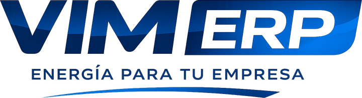
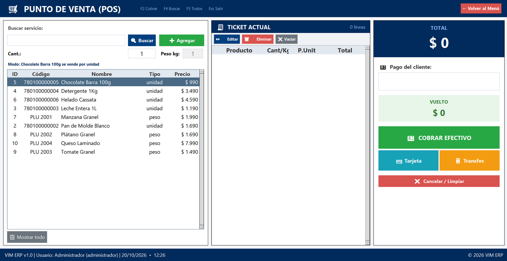
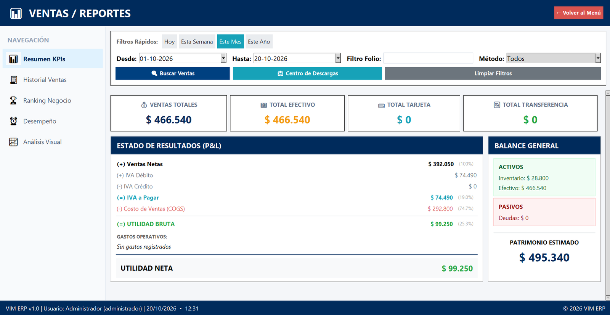
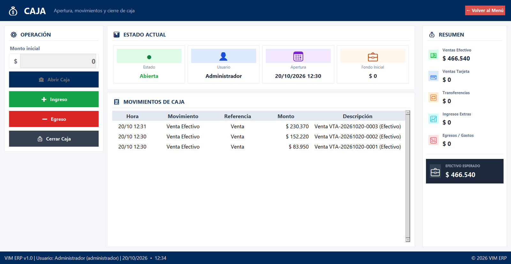

<p align="center">
  
</p>

<p align="center">
  <b>Punto de venta y administración gratis para pequeños negocios en Chile.</b><br>
  Vende, controla tu stock, abre y cierra caja y entiende si tu negocio está ganando plata.
</p>

<p align="center">
  <a href="https://github.com/diegobustamanter-netizen/VIM_ERP/releases/download/1.0/VIM_ERP_v1.0_Windows.zip"></a>
  <a href="https://diegobustamanter-netizen.github.io/VIM_ERP/"></a>
</p>

<p align="center">
  
  
  
  
</p>

---

## ¿Qué es?

VIM ERP es un programa para el día a día de un negocio chico: almacén, minimarket, tienda, peluquería, taller o consulta. Se instala en el computador del negocio, funciona sin internet y tus datos no salen de ese equipo. Es gratis, sin cuentas ni suscripciones.

<p align="center">
  
</p>

## Qué puedes hacer

| | |
|---|---|
| 🛒 **Punto de venta** | Vende con lector de código de barras o buscando por nombre. Productos por unidad o por peso. Cobro en efectivo con cálculo de vuelto, tarjeta o transferencia. |
| 🧾 **Comprobantes** | Impresoras térmicas de 58 mm y 80 mm, o en PDF para mandarlo por WhatsApp o correo. |
| 📦 **Productos e inventario** | Stock, stock mínimo, categorías, proveedores e historial de movimientos. También sirve para negocios de servicios, sin stock. |
| 💰 **Caja** | Apertura, ingresos y egresos, y cierre con arqueo: te dice si cuadró, sobró o faltó plata. |
| 📊 **Reportes** | Estado de resultados, IVA, gráficos de ventas por día y por hora, medios de pago y productos más vendidos. Exporta a Excel. |
| 🏢 **Administración** | Compras, gastos, cuentas por pagar, personal y liquidaciones. |
| 👥 **Usuarios** | Roles y permisos por módulo, para que cada cajero vea solo lo que necesita. |
| 🛡️ **Copias de seguridad** | Respaldo y restauración de toda la información con un clic. |

<p align="center">
  
  
</p>

> **Importante:** VIM ERP emite comprobantes internos de venta. **No emite boletas ni facturas electrónicas del SII.** Para eso necesitas el sistema del SII o un proveedor certificado.

## Cómo empezar

1. Descarga [VIM_ERP_v1.0_Windows.zip](https://github.com/diegobustamanter-netizen/VIM_ERP/releases/download/1.0/VIM_ERP_v1.0_Windows.zip) y descomprímelo en una carpeta tuya.
2. Abre `VIM_ERP.exe`. Si Windows muestra la pantalla azul «Windows protegió su PC», haz clic en **Más información** y luego en **Ejecutar de todas formas**. Aparece porque el programa no está firmado digitalmente, no porque tenga algo malo.
3. Entra con el usuario `admin`; la clave inicial aparece en la pantalla de acceso. Un asistente te pregunta si tu negocio vende productos o servicios y te pide una pregunta de seguridad.
4. Cambia la clave del administrador apenas entres.

El ZIP incluye el **Manual de Uso** con capturas, explicado paso a paso para el dueño del negocio y sus cajeros.

Tus datos quedan en `%LOCALAPPDATA%\VIM_ERP`. Haz copias de seguridad seguido y guárdalas también fuera del computador.

## Contacto

¿Dudas, sugerencias o encontraste un error? Escribe a **vimerpchile@gmail.com** o abre un [issue](../../issues).

---

## Para desarrolladores

Hecho en Python con Tkinter y SQLite.

### Ejecutar desde el código

Requiere Python 3.10 o superior en Windows 10/11.

```bat
pip install -r requirements.txt
python ventana_principal.py
```

También puedes usar `instalar_dependencias.bat` y después `run.bat`.

### Pruebas automáticas

```bat
test.bat
```

Las pruebas usan una base temporal: tu base real no se toca. Más detalles en [tests/README.md](tests/README.md).

### Compilar el ejecutable

```bat
pip install pyinstaller
build.bat
```

El ejecutable queda en `dist\VIM_ERP.exe`.

### Publicar una versión

`crear_paquete_distribucion.bat` corre las pruebas, compila el `.exe` y arma `..\VIM_ERP_v1.0_Windows.zip` con el ejecutable, el manual, el LEEME, la licencia y la huella SHA-256. La versión se cambia en la línea `set "VERSION=..."` del mismo archivo.

## Licencia

[MIT](LICENSE) © 2026 Diego Francisco Bustamante Ríos. Gratis para usar, copiar y modificar.
